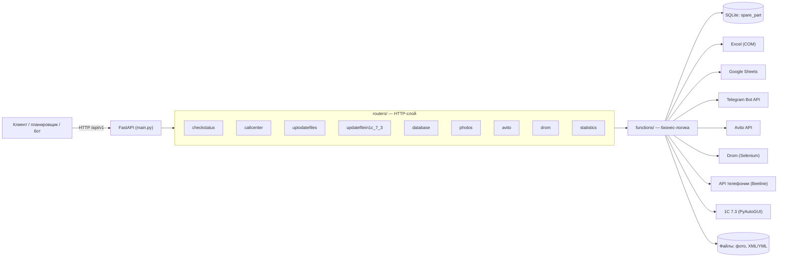

# GlessGroup FastAPI

> Внутренний REST API-сервис на **FastAPI**, в который перенесена логика консольного приложения компании: выгрузка прайс-листов на торговые площадки, управление call-центром, контроль актуальности файлов, обработка фотографий товаров и автоматизация работы в 1С.


---

## 📌 О проекте

Раньше рабочие процессы компании выполнялись набором консольных скриптов: их запускали вручную или по расписанию, а результат нельзя было получить из других систем. Проект переводит эти процессы на **микросервисную архитектуру**: каждая операция стала HTTP-методом, который можно вызвать из планировщика, Telegram-бота, внешней системы или обычным запросом из браузера.

**Какие задачи решает сервис:**

| Задача | Как решается |
|--------|--------------|
| Выгрузка каталога на площадки | Данные из 1С загружаются в SQLite, из них формируются прайс-листы для **Дрома, Авито, 2ГИС и VK** |
| Управление call-центром | Статусы сотрудников в телефонии включаются и выключаются автоматически по графику работы из Excel |
| Контроль выгрузок | Проверяется, обновлялись ли файлы за последние сутки; при просрочке в Telegram уходит оповещение |
| Контроль рекламного бюджета | Получение баланса Авито и Дрома, расчёт, на сколько дней хватит средств, оповещение ответственных |
| Подготовка фотографий товаров | Сжатие и кадрирование, переименование, раскладка по папкам, сравнение старых и новых изображений |
| Автоматизация 1С 7.3 | Управление удалённым рабочим столом с помощью имитации действий мыши и подтверждающими скриншотами |
| Журналирование | Действия пишутся в стандартный лог и в Google Таблицы |

---

## 🏗 Архитектура



**Принципы:**

1. **Разделение ответственности.** `routers/` принимают запросы и формируют ответы, `functions/` содержат прикладную логику.
2. **Модульность.** Каждая предметная область — отдельный `APIRouter` со своим тегом в документации.
3. **Версионирование.** Все методы публикуются под префиксом `/api/v1`.
4. **Валидация ответов.** Для модуля фотографий используется Pydantic-схема `photosPydantic` (`response_model`).
5. **Наблюдаемость.** Логирование уровня `INFO` с временем и именем логгера; результаты ключевых операций дублируются в Google Таблицы.
6. **Измерение времени.** Декоратор `@executiontime` добавляет в ответ длительность тяжёлых операций (генерация прайс-листов, импорт базы).

---

## 📁 Структура проекта

```
glessgroupfastapi/
├── main.py                     # Точка входа: приложение, роутеры, логирование, /static
├── requirements.txt
├── routers/                    # HTTP-слой
│   ├── checkstatus.py          # Проверка работоспособности
│   ├── callcenter.py           # Call-центр
│   ├── uptodatefiles.py        # Контроль актуальности файлов
│   ├── updatefilein1c_7_3.py   # Автоматизация 1С 7.3
│   ├── database.py             # БД и генерация прайс-листов
│   ├── photos.py               # Обработка фотографий
│   ├── avito.py                # Интеграция с Авито
│   ├── drom.py                 # Интеграция с Дромом
│   ├── statistics.py           # Сбор статистики (заготовка)
│   └── tests/                  # Автотесты (pytest)
└── functions/                  # Бизнес-логика
    ├── database.py             # Работа с SQLite, декоратор времени выполнения
    ├── exportfiles.py          # Формирование XML/YML для площадок
    ├── excel.py                # Чтение графиков из Excel (COM)
    ├── logger.py               # Логирование в Google Sheets, оповещения в Telegram
    ├── photos.py               # Сжатие, кадрирование, переименование изображений
    ├── uptodate.py             # Определение «устаревших» файлов
    ├── movemouse.py            # Управление мышью и скриншоты (PyAutoGUI)
    ├── selenium_drom.py        # Сохранение и загрузка сессии браузера
    └── timedtasks.py           # Запуск задач по расписанию (в разработке)
```

---

## 🔌 Описание API

Базовый префикс: `/api/v1`. Интерактивная документация: `/documentaion`.

### CheckStatus
| Метод | Путь | Описание |
|-------|------|----------|
| GET | `/` | Проверка доступности сервиса |

### CallCenter
| Метод | Путь | Описание |
|-------|------|----------|
| GET | `/inclusion/{user_id}` | Включить сотрудника в call-центре по короткому номеру |
| GET | `/shutdown/{user_id}` | Выключить сотрудника |
| GET | `/receivingdatesfromexcel` | Получить из Excel график работы на текущий месяц |
| GET | `/activatemanagersonday` | Включить или выключить всех менеджеров на сегодня в соответствии с графиком (выходной, отпуск и т. п. — выключение) |
| GET | `/updatingexcelfile` | Актуализировать рабочую копию файла с графиком, если основной файл изменился |

### UpToDatesFiles
| Метод | Путь | Описание |
|-------|------|----------|
| GET | `/uptodatedatabase` | Проверить актуальность файла базы данных |
| GET | `/uptodatedrom` | Проверить прайс-лист для Дрома |
| GET | `/uptodateavito` | Проверить прайс-лист для Авито |
| GET | `/uptodatedoublegis` | Проверить прайс-лист для 2ГИС |
| GET | `/uptodatedatabaseprices` | Проверить базу и все прайс-листы одним запросом |

Файл считается устаревшим, если не изменялся более суток. В этом случае ответственным уходит сообщение в Telegram.

### UpToDatesFilesIn1C7.3
Автоматизация операций в 1С 7.3 на удалённом рабочем столе: последовательность кликов, ожидание и подтверждающий скриншот.

| Метод | Путь | Описание |
|-------|------|----------|
| GET | `/putdownbalances` | Проставить остатки |
| GET | `/formpricelist` | Сформировать прайс-лист (выгрузка товаров на сайт) |
| GET | `/confirmnewdata` | Подтвердить смену рабочей даты |
| GET | `/closetable` | Закрыть файл с проставленными остатками |

### DataBase
| Метод | Путь | Описание |
|-------|------|----------|
| POST | `/initdatabasefile` | Создать файл SQLite и таблицу `spare_part` |
| POST | `/insertnewdatesindatabase` | Загрузить выгрузку из 1С (XML) в базу: новые позиции добавляются, существующие обновляются |
| POST | `/createxmlfiledrom` | Сформировать два прайс-листа для Дрома: «в наличии» и «под заказ» |
| POST | `/createxmlfileavito` | Сформировать XML для Авито (формат `Ads`, версия 3) |
| POST | `/createymlfiledoublegis` | Сформировать YML для 2ГИС |
| POST | `/createymlfilevk` | Сформировать YML для VK |

В прайс-листы не попадают позиции «под заказ» и услуги (кроме Дрома, для которого формируется отдельный файл «под заказ»).

### Photos
| Метод | Путь | Описание |
|-------|------|----------|
| GET | `/scanfolderforparsing` | Разобрать папку с новыми фотографиями: сжать до 1920×1440, кадрировать, переименовать, разложить по папкам, записать данные в Google Таблицы |
| GET | `/scanfolder` | Сравнить две папки и скопировать недостающие файлы |
| GET | `/lowwerfilesfromfolder` | Привести имена файлов в папке к нижнему регистру |
| GET | `/renameallfilesfromfolers` | То же для всех папок 1С и сайта |
| GET | `/comparisonfolders` | Сопоставить все папки 1С и сайта |
| GET | `/picturematching` | Сравнить два изображения по индексу структурного сходства (SSIM); при сходстве ниже 80 % рекомендуется заменить картинку |
| GET | `/replacingimages` | Пройти по двум папкам и оценить, какие фотографии нужно заменить |

### Avito
| Метод | Путь | Описание |
|-------|------|----------|
| GET | `/getaccesstoken` | Получить токен OAuth (`client_credentials`) |
| GET | `/getcurrentbalance` | Получить баланс аккаунта |
| GET | `/calcavaragedaily` | Рассчитать средние траты в день |
| GET | `/decisionmaking` | Рассчитать, на сколько дней хватит баланса, и отправить отчёт в Telegram: при остатке в 3 дня и менее — предупреждение о необходимости пополнения |

### Drom
| Метод | Путь | Описание |
|-------|------|----------|
| GET | `/getinfobalance` | Получить баланс личного кабинета через браузер (Selenium); сессия сохраняется в cookie, повторная авторизация не требуется |

### Statistics
Роутер подключён, эндпоинты запланированы.

---

## 🛠 Технологии

**Язык и веб**
- **Python 3.12+**
- **FastAPI** — REST API, OpenAPI/Swagger, маршрутизация через `APIRouter`
- **Pydantic** — валидация и сериализация ответов
- **Uvicorn** — ASGI-сервер
- **requests** — HTTP-клиент для внешних API

**Данные и форматы**
- **SQLite** (`sqlite3`) — локальное хранилище каталога запчастей
- **XML / YML** (`xml.etree.ElementTree`, `lxml`) — формирование и разбор прайс-листов
- **openpyxl**, **Excel COM (pywin32)** — работа с Excel, в том числе с файлами под паролем
- **tqdm** — индикатор прогресса

**Интеграции**
- **Avito API** — авторизация OAuth 2.0, получение баланса
- **API виртуальной АТС (Beeline)** — управление статусами операторов
- **Google Sheets** (`gspread`, сервисный аккаунт) — журнал операций
- **Telegram Bot API** (`pyTelegramBotAPI`) — оповещения ответственных
- **Selenium (Chrome)** — работа с кабинетом Дрома, сохранение сессии в cookie

**Обработка изображений**
- **Pillow** — сжатие, масштабирование, кадрирование
- **OpenCV** и **scikit-image** — сравнение изображений по SSIM
- **NumPy**

**Автоматизация рабочего стола**
- **PyAutoGUI** — управление мышью, скриншоты
- **pywin32** — COM-автоматизация Excel и системные вызовы Windows

**Качество и инструменты**
- **pytest** + `fastapi.testclient.TestClient` — автотесты
- **logging** — журналирование
- **Git / GitHub**

---

## 🚀 Установка и запуск

### Требования
- **Windows** (используются Excel COM, `pywin32`, управление рабочим столом)
- **Python 3.12+**
- Google Chrome и подходящий ему драйвер (для Selenium)
- Microsoft Excel (для чтения графиков)

### Шаги

```bash
git clone https://github.com/Fllleshka/glessgroupfastapi.git
cd glessgroupfastapi

python -m venv venv
venv\Scripts\activate

pip install -r requirements.txt

# Конфигурация: скопируйте шаблон и заполните своими значениями
copy dates.example.py dates.py

# Папки, которые использует приложение
mkdir static
mkdir screenshots\proofofwork
mkdir exportfiles\drom exportfiles\avito exportfiles\2gis exportfiles\vk

python main.py
# или
uvicorn main:app --reload
```

Сервис будет доступен на `http://127.0.0.1:8000`, документация — на `http://127.0.0.1:8000/documentaion`.

### Конфигурация (`dates.py`)

Настройки, пути и ключи вынесены в модуль `dates.py` в корне проекта. Он **не входит в репозиторий**, так как содержит секреты; готовый шаблон лежит в `dates.example.py` (секреты можно передавать и переменными окружения). Модуль предоставляет следующие объекты:

| Объект | Назначение |
|--------|-----------|
| `allsotr` | Список сотрудников: короткие номера, имена, Telegram ID администраторов |
| `beeline` | Адрес и параметры API телефонии, заголовки авторизации |
| `datesforexcelfiles` | Пути к файлам Excel с графиком и пароль |
| `googlesheets` | Путь к файлу ключей сервисного аккаунта Google |
| `telegrambot` | Токен Telegram-бота |
| `datesforavito` | `client_id` и `client_secret` Авито |
| `datesfordrom` | Адрес, логин, пароль и путь к cookie для Дрома |
| `pathsfiles` | Пути к базе данных, прайс-листам, папкам фотографий и выгрузке из 1С |
| `textforsummary`, `textforpricelists` | Тексты описаний и шаблоны для прайс-листов |
| `colorsforbuttons` | Цвета для оформления записей в Google Таблицах |

---

## 🧪 Тестирование

```bash
pytest routers/tests
```

Тесты используют `TestClient` и проверяют ответы API без запуска сервера.

---

## 🗺 Планы развития

- [ ] Перейти на параметризованные SQL-запросы во всех функциях работы с БД
- [ ] Перенести конфигурацию с модуля `dates.py` на `.env` и `pydantic-settings`
- [ ] Заменить `GET` на `POST` у методов, изменяющих состояние
- [ ] Добавить авторизацию (API-ключ или JWT) для внутренних методов
- [ ] Реализовать запуск задач по расписанию (`functions/timedtasks.py`)
- [ ] Наполнить модуль статистики
- [ ] Расширить покрытие тестами и добавить моки внешних сервисов
- [ ] Зафиксировать версии зависимостей и добавить Docker для компонентов, не завязанных на Windows
- [ ] Выделить крупные модули (прайс-листы, фотографии, интеграции с площадками) в самостоятельные микросервисы

---

## 👤 Автор

**Fllleshka** — [github.com/Fllleshka](https://github.com/Fllleshka)
